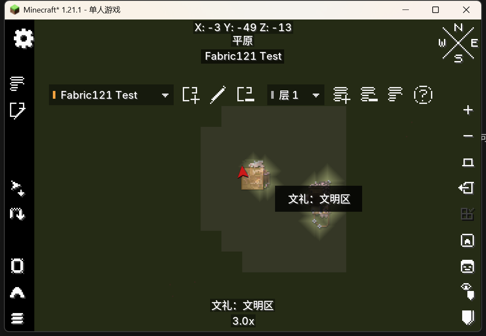
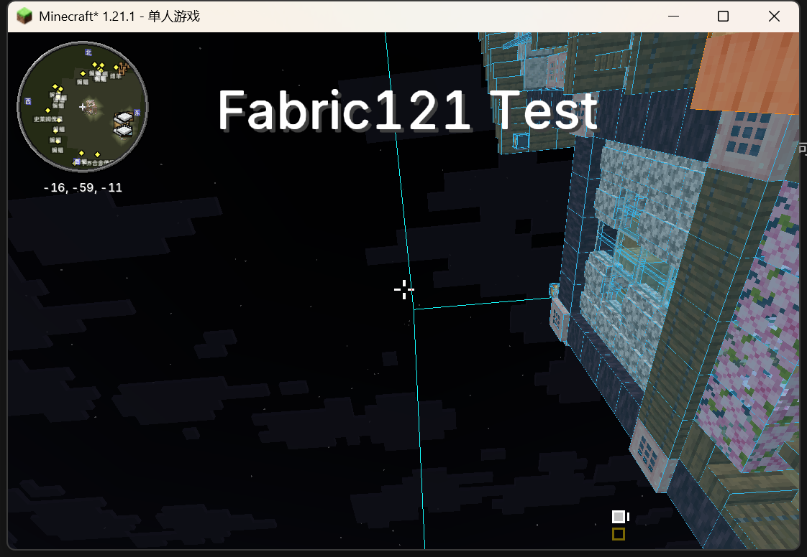

# Fabric 1.21.1 验证记录

2026-10-21，工程连同 Git 历史和开发工具迁移到 `C:/Users/Lenovo/Desktop/desktop/工程/编程学习/mod/hereby-named`。原实例中的源码目录已移走。

## 构建与自动测试

- Fabric 1.21.1、Loader 0.19.3、Fabric API 0.116.13+1.21.1、Xaero World Map 1.44.2 / XaeroLib 1.7.1，Java 21 字节码。
- 保留 Fabric 1.20.1、Loader 0.17.2、World Map 1.47.0 / XaeroLib 1.7.3，Java 17 字节码。
- JDK 21 下两个版本的完整 `build` 均通过；1.21.1 为 18 项测试，1.20.1 为 16 项。
- 新增 1.21.1 typed CustomPayload 编解码测试：80 KB 数据分片往返、单包上限、非法分片数拒绝。原有四处公开边界的测试继续保留。
- Windows 中文工程路径下，使用 ASCII 路径的 manifest classpath jar 避开 Java 参数文件的本地编码差异；两个版本的测试均实际运行。

## 使用指定存档副本实测

原存档：`D:/Game/PCL2/.minecraft/versions/【云游四海】WAYFARING/saves/新的世界 (1)`。

使用 `scripts/smoke-client.ps1` 复制整合包配置、模组与完整存档到 `.tools/smoke-1.21.1`，仅打开副本 `saves/Hereby Named Test`。整合包部分优化模组要求 Java 25，故整包实测使用 Java 25；附属模组构建目标仍为 Java 21。

- 原整合包 739 个模组（含嵌套依赖）与本模组成功启动并进入世界，未出现本模组入口或 Mixin 错误。
- 打开世界地图，进入编辑模式，使用可视化色板创建 `Fabric121 Test` 区域。
- 单击已记录区块，实际显示橙色覆盖；顶部坐标、原有“平原”文字、区域名称按顺序显示。
- 集成服务器处理编辑，副本中 `hereby-named/regions` 实际写入自定义维度 `superflatdimension:overworld` 的区域文件。
- 退出地图后，Traveler's Titles 5.1.3 的渲染器实际显示 `Fabric121 Test` 标题。
- 测试客户端正常退出。原存档 `level.dat` 的 SHA-256 与测试准备前记录一致。
- 另用 JDK 21 执行 1.21.1 `runServer --args=nogui`，仅加载服务端 Fabric API 与本模组，正常停在首次 EULA 提示；未发生客户端类或 Xaero 类引用错误。此项为服务端加载检查，未启动世界或验证双客户端同步。

## 验证边界

尚未完成两台客户端连接独立服务器的同步实测，也未全面回归所有拖动手势、双行标题动画或其他 Xaero 版本。1.21.1 网络分片有自动测试，集成服务器实测覆盖请求、锁、快照与保存路径。

0.2.0 使用 `regions_v2` 网络通道，客户端和服务器需一同更新；磁盘区域格式保持兼容。
