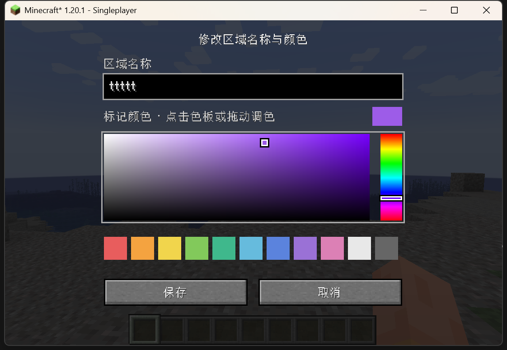
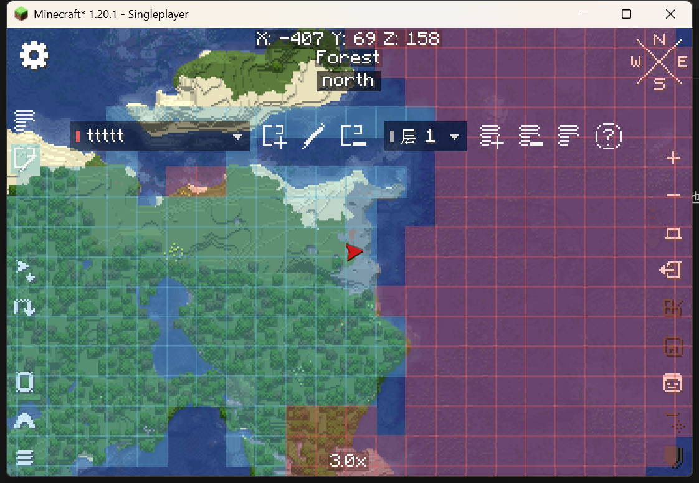
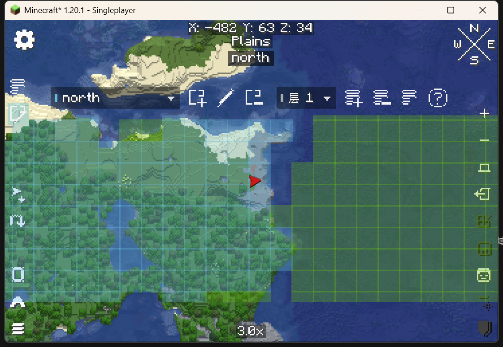
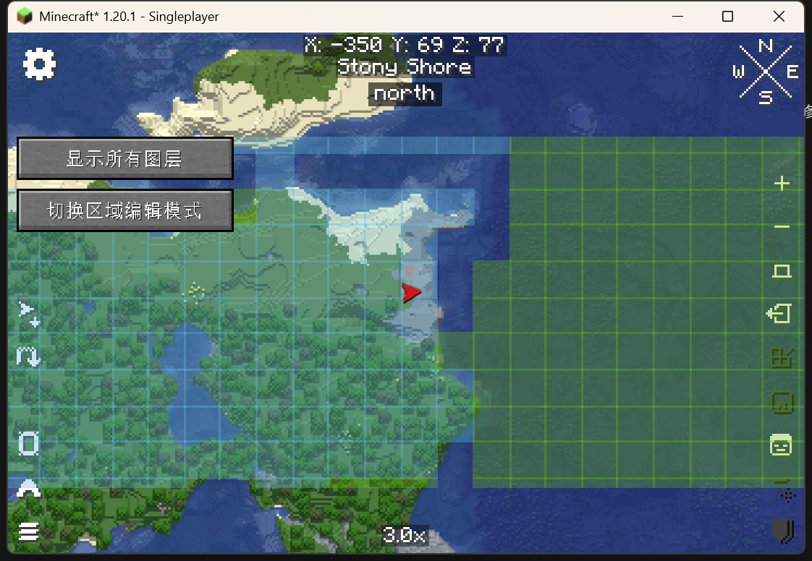

# 首版验证记录

## 全视口着色与可视化选色

- 区域覆盖的裁剪边界改为完整地图视口，移除工具栏下方至倍率文字上方的横条限制。隔离客户端确认顶部、底部已记录区块的颜色连续显示。
- 创建／修改区域改用常用色板、可拖动色相条和饱和度／明暗面板，实时显示所选颜色，无需输入十六进制代码。已有颜色与名称在窗口重建时保留。
- 实测点击红色色板、拖动色相至紫色、调整饱和度与明暗、保存到服务器以及重新打开后保留所选颜色。
- 完整构建及 16 项现有自动测试通过。

## 地图 UI 调整

- 改为直接复用 Xaero `GuiTexturedButton` 与原生悬停提示：20×20 逻辑像素点击区域、16×16 自绘像素图标、透明背景与原生高亮。
- 左侧编辑／显示入口缩为图标，顶部区域和图层选择器改为半透明紧凑样式；区域色条标记颜色。操作按钮窄屏自动换行，帮助移至问号悬停提示。
- 下拉菜单根据内容收缩，使用灰黑透明样式；打开下拉时关闭工具栏提示以避免遮挡菜单。
- 隔离客户端检查了地图入口、编辑工具栏、原生悬停提示、区域下拉选择；完整构建及 16 项测试通过。

首版针对 Minecraft 1.20.1 / Java 17 / Fabric Loader 0.17.2 / Fabric API 0.92.6+1.20.1 / Xaero World Map 1.47.0。Traveler's Titles 兼容目标为 1.20-Fabric-4.0.2。

## 自动验证

- Gradle 编译 Java 源码、执行 JUnit 5 测试并生成重映射 jar。
- 最终完整构建通过：16 项测试，0 失败、0 错误；Standards / Spec 两轴独立审查及修复复核记录见 [review.md](review.md)。
- 区域测试：同层覆盖、跨层保留、撤销恢复、图层删除恢复及编号、首尾区域名、显示过滤、右键不擦除别的区域。
- 群系测试：边连通、角不连通、未知区块截断、异步等待已记录地图、超大选择整次拒绝。
- 标题测试：稳定 1 秒、等待原有标题、仅保留最新地点、空区域、跨维度重新触发。
- 权限测试：未授权不能取得锁、同维度排他、跨维度独立、撤销权限后不可写、断线释放。
- 存档测试：名称颜色负坐标和编号往返、维度隔离、损坏文件报错。
- 传输测试：600000 字节负载分片，每包小于客户端到服务器的 32767 字节限制，完整重组，拒绝缺失／乱序分片。
- 应答关联测试：READ 先到不结束锁申请，错误维度不完成请求，取消后迟到的应答不完成新申请，请求和快照保留关联 ID。
- Windows 长自定义维度保存、备份、读取及维度隔离测试通过。

## 独立服务端加载

- `runServer` 实际加载此地名曰和 Fabric API，未出现客户端类引用或模组入口错误。
- 运行停在正常的首次 EULA 提示，未代替用户接受 EULA；该检查仅证明服务端加载路径，不视为完整多人实测。

## 隔离客户端实测

使用现有实例的运行库与资源，在 `.tools/smoke-client` 创建独立游戏目录，未打开原有存档。

- Fabric 实际加载生成的 jar、Xaero World Map、Traveler's Titles 及其依赖，未出现模组加载或 Mixin 错误。
- 新建临时世界，打开世界地图，显示图层开关及编辑入口。
- 进入编辑模式，显示区域与图层工具栏；新建 `north` 区域，指定颜色，选择已记录的森林区块，地图显示彩色覆盖。
- 顶部按坐标、原有 `Forest` 群系文本、`north` 区域文本的顺序显示，位置固定。
- 编辑通过集成服务器持有的数据完成，区域文件实际写入临时世界的 `hereby-named/regions`。
- 修复审查问题后，使用最终 jar 重启隔离客户端，重新打开临时世界；已保存区域正常读取，顶部名称显示正确，可重新取得编辑锁进入工具栏。未出现新增的模组或同步错误。

## 验证边界

- 尚未做两台客户端连接同一独立服务器的端到端同步实测；自动测试覆盖相关核心规则及网络分片，集成服务器实测覆盖请求、快照和保存路径。
- 地图按钮、单区块选择及地图区域文本已有实测；完整手势组合、超大地图与全部现有整合包模组组合仍需要更长时间游玩回归。
- Traveler's Titles 样式复用采用反射连接独立渲染器；标题排队规则有自动测试，尚需在实际游玩中全面核对动画与用户自定义样式。
- 1.20 与 1.21.1 需要单独适配网络和界面 API。当前 jar 仅声明 Minecraft 1.20.1，未将兼容目标当作已经支持的版本。
- 服务器校验编辑权限、维度锁、修订号及数据界限；“仅编辑操作者已记录地图”由客户端地图适配器执行，因为服务器不持有玩家的 Xaero 地图记录。
- 层号历史最大值不因撤销新建图层而回退；历史限最近 32 步，另有 2000000 个历史区块引用的预算，达到预算时丢弃最旧撤销步骤。
